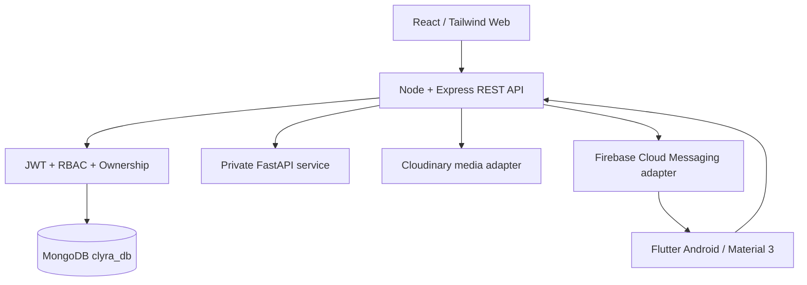
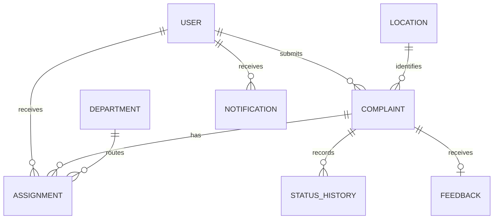

# Architecture

Node is the sole business orchestrator. MongoDB holds users, complaints, status histories, assignments, notifications, feedback, locations, announcements and audits. Clients never query MongoDB or FastAPI directly. AI outages degrade to human review, without rejecting complaints.

